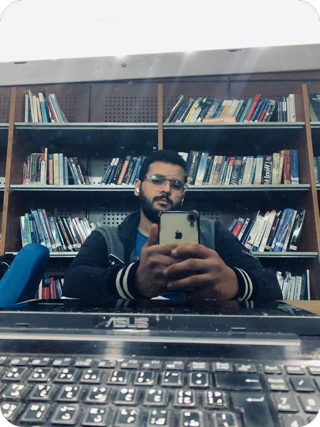
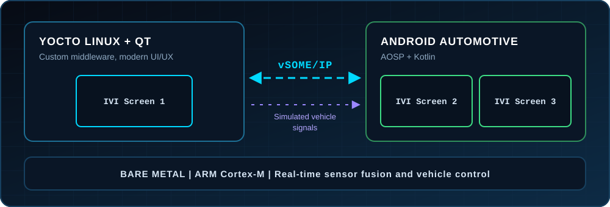

<!-- header-config
HEADER SETTINGS. Edit the text after each colon, then commit and push.
The header image rebuilds itself in about a minute.
Add or remove lines under "roles" as you like.
Need another tag line? Add "tag_line_3: your text" (up to 3 tag lines fit).

tag_line_1: Software Engineer
tag_line_1: ITI · INTAKE 45
tag_line_2: CAIRO, EGYPT
name: PATRICK ATEF
roles:
  - Embedded Software Developer
  - Embedded Linux · Yocto
  - Android Automotive · AOSP
  - Android Mobile Apps · Kotlin
  - ISTQB Certified Professional
-->

<!-- ===================== HEADER ===================== -->

 

  

 

<!-- ===================== ABOUT ===================== -->
## About Me

I build software that lives inside vehicles and on embedded hardware, from bare-metal firmware to Linux middleware to Android Automotive infotainment.

**Location:** Cairo, Egypt  
**Education:** ITI, Intake 45  
**Specialization:** Embedded Systems, Android Automotive  
**Focus:** Embedded Linux, AOSP, In-Vehicle Infotainment (IVI)  
**Certification:** ISTQB Certified Professional  

### What I do

- Build **Android Automotive OS** apps and IVI systems on AOSP
- Develop custom Linux distributions with **Yocto** and **Qt** middleware
- Write bare-metal and RTOS firmware for **ARM Cortex-M**
- Build Android mobile apps in **Kotlin** and **Java**
- Implement vehicle middleware and communication protocols (vSOME/IP, CAN, I2C/SPI)

 

<!-- ===================== FEATURED PROJECT ===================== -->
## Featured Project

### [PAO – Power Of Three](https://github.com/PAO-PowerOfThree)
**ITI Graduation Project · Multi-Domain Automotive Platform**

| Layer | Hardware and Stack | Role |
|:--|:--|:--|
| **Bare Metal** | ESP32 + STM32 | Fingerprint authentication, sensor data collection, real-time input processing, SHA security |
| **Embedded Linux** | Raspberry Pi 3B+ · Yocto + meta-pao | Central bridge node, Qt6 cluster UI, data processing hub, vsomeip communication |
| **Android Automotive** | Raspberry Pi 5 · AOSP 15 + VHAL | User interface, HVAC and media control, voice assistant and GPS, OTA updates and child mode |

- Bare metal to Yocto over **CAN Bus** (sensor data) and **UART** (fingerprint events)
- Yocto and Android linked over **vsomeip on Ethernet**, with event-driven bidirectional communication
- Multi-display IVI setup: **1 Qt-based screen on Yocto + 2 Android Automotive screens**
- End-to-end security: SHA hashing, secure authentication and protected OTA updates

 

<!-- ===================== TECH STACK ===================== -->
## Tech Stack

**Languages** 

**Platforms & Frameworks** 

**Tools** 

 

 

<!-- ===================== CONTACT ===================== -->
## Let's Collaborate

 

 

