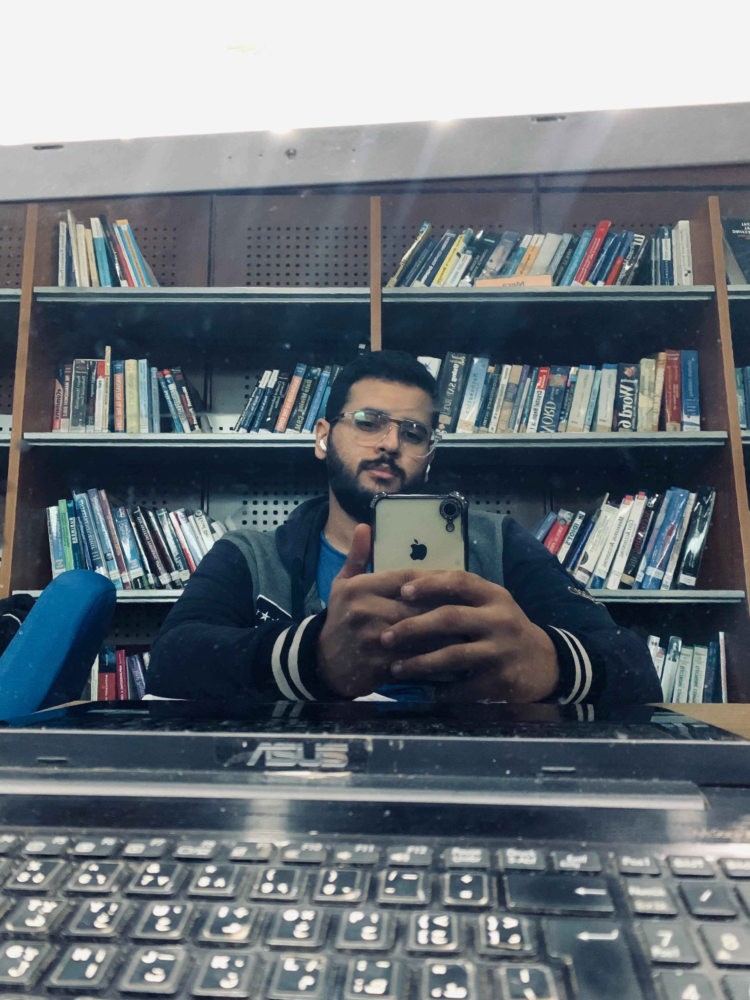
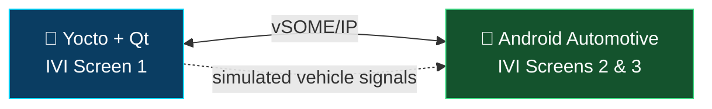

<!-- ===================== HEADER ===================== -->
<div align="center">



<br/><br/>


<br/><br/>

<a href="https://www.linkedin.com/in/patrick-atef-9826a6244/"></a>
<a href="mailto:patrickatefffa22@gmail.com"></a>
<a href="https://github.com/PatrickAtef8?tab=repositories"></a>

</div>

<br/>

<!-- ===================== ABOUT ===================== -->
## 👨‍💻 About Me

<div align="left">



I build software that lives inside vehicles and on embedded hardware, from bare-metal firmware to Linux middleware to Android Automotive infotainment.

**Location:** Cairo, Egypt  
**Education:** ITI – Intake 45  
**Specialization:** Embedded Systems, Android Automotive  
**Focus:** Embedded Linux, AOSP (Android Open Source Project), In-Vehicle Infotainment Systems  

</div>

<br clear="right"/>

```kotlin
val patrick = Engineer(
    name        = "Patrick Atef",
    location    = "Cairo, Egypt 🇪🇬",
    education   = "ITI – Intake 45",
    focus       = listOf("Embedded Linux", "AOSP", "In-Vehicle Infotainment"),
    languages   = listOf("C", "C++", "Kotlin", "Java"),
    certified   = "ISTQB",
    currentGoal = "Ship reliable automotive software"
)
```

| | |
|---|---|
| 🚗 **Android Automotive** | AAOS apps and IVI systems on AOSP |
| 🐧 **Embedded Linux** | Custom distributions with Yocto, Qt middleware |
| ⚙️ **Firmware** | Bare-metal and RTOS code for ARM Cortex-M |
| 📱 **Mobile** | Android apps in Kotlin and Java |
| 🔌 **Vehicle comms** | Vehicle middleware, vSOME/IP, CAN, I2C/SPI |

<br/>

<!-- ===================== FEATURED PROJECT ===================== -->
## 🚀 Featured Project

<div align="center">

### [⚡ PAO – Power Of Three](https://github.com/PAO-PowerOfThree)
**ITI Graduation Project · Multi-Domain Automotive Platform**

</div>

| Domain | Technology | Implementation |
|:--|:--|:--|
| 🔩 **Bare Metal** | ARM Cortex-M | Real-time sensor fusion and vehicle control |
| 🐧 **Linux Stack** | Yocto + Qt | Custom middleware with a modern UI/UX |
| 🤖 **AAOS** | AOSP + Kotlin | Connected infotainment experience |



- 🔗 IPC between Yocto and Android over **vSOME/IP**
- 🖥️ Multi-display IVI setup: **1 Qt screen on Yocto + 2 AAOS screens**
- 📡 Real-time sharing of simulated vehicle signals across systems

<div align="center">
<a href="https://github.com/PAO-PowerOfThree"></a>
</div>

<br/>

<!-- ===================== TECH STACK ===================== -->
## 🛠️ Tech Stack

<div align="center">

**Languages**<br/>


**Platforms & Frameworks**<br/>


**Tools**<br/>


</div>

<br/>

<div align="center">


</div>

<br/>

<!-- ===================== STATS ===================== -->
## 📊 GitHub Analytics

<div align="center">


<br/>


<br/>


<br/>


</div>

<br/>

<!-- ===================== SNAKE ===================== -->
<div align="center">

<picture>
  <source media="(prefers-color-scheme: dark)" srcset="https://raw.githubusercontent.com/PatrickAtef8/PatrickAtef8/output/github-snake-dark.svg" />
  <source media="(prefers-color-scheme: light)" srcset="https://raw.githubusercontent.com/PatrickAtef8/PatrickAtef8/output/github-snake.svg" />
  
</picture>

</div>

<br/>

<!-- ===================== CONTACT ===================== -->
## 🤝 Let's Collaborate

<div align="center">

**Open to opportunities in**

Embedded Systems Engineering · Automotive Software Development · Android Automotive OS<br/>
Android Mobile Apps · Software Testing · IoT Solutions · System Architecture

<br/>

<a href="https://www.linkedin.com/in/patrick-atef-9826a6244/"></a>
<a href="mailto:patrickatefffa22@gmail.com"></a>

<br/>

</div>

<br/>

<div align="center">

</div>
